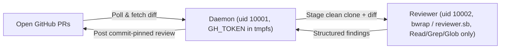

# pr-auto-review

[](https://github.com/hanzhad/pr-auto-review/actions/workflows/ci.yml)
[](LICENSE)

Continuous containerized pull request auto-reviewer across GitHub repositories — with two-UID isolation, no-shell sandboxing, and RAM-only credential delivery.

## Why

Letting an LLM coding agent review untrusted pull requests on your main machine exposes your GitHub tokens, SSH keys, and shell.

`pr-auto-review` isolates the reviewer behind two distinct boundaries:

- **Privilege split (`uid 10001` -> `uid 10002`):** The daemon (`uid 10001`) holds `GH_TOKEN` in `tmpfs` RAM, clones repositories, and posts reviews. The LLM reviewer runs as an unprivileged user (`uid 10002`) inside a `bwrap` / `sandbox-exec` (`reviewer.sb`) perimeter with **no shell tool** (`--tools "Read,Grep,Glob"`).
- **Idempotent commit-pinned reviews:** Every review is tied to the PR's `commit_id`. Pushing a new commit triggers a fresh pass; replying to a finding closes it.

## Architecture & Threat Model



## Quick Start

```sh
# 1. Build and start the hardened container
bin/auto-review up -d

# 2. Store a harness credential (stdin, or interactive login)
printf '%s' "$CLAUDE_CODE_OAUTH_TOKEN" | bin/auto-review credential set claude
# or: bin/auto-review login claude

# 3. Inject a GitHub token for a repository (or pair with pin-vault)
printf '%s' "$GH_TOKEN" | bin/auto-review unlock-token --name acme-webapp

# 4. Register a repository and follow logs
bin/auto-review setup owner/repo
bin/auto-review logs -f
```

> **Note:** Always run container CLI commands via `bin/auto-review` (or `docker exec -i -u 10001 auto-review auto-review ...`) so files under `/run/auto-review` stay owned by `uid 10001`.

## Example Review Output

```markdown
<!-- auto-review:commit=a1b2c3d4 verdict=findings count=1 -->
1. **[high]** `src/auth/session.ts:42` — `verifyToken()` falls back to an empty secret when `JWT_SECRET` is unset, allowing forged tokens to validate.
```

When no issues are found, `pr-auto-review` posts a clean commit-pinned review (`No findings`) so downstream gates like [`pr-gate`](https://github.com/hanzhad/pr-gate) can verify the exact `headRefOid`.

## What the reviewer is given

The reviewer receives a staged repository clone, the PR diff, and `prompt/task.md`. Findings are restricted to concrete bugs backed by `Invariant:` and `Test:` evidence (never `taste` or `speculative` style nitpicks), plus **five structural defect classes**:

1. **Overfit / adjacent valid or invalid input** — logic that only passes the exact test fixture.
2. **Canonical helper / sibling copy** — duplicated logic instead of updating the canonical owner.
3. **Reader/Writer mismatch** — patching a reader to tolerate malformed writer output.
4. **Caller-specific branch / unindexed payload** — ad-hoc special cases or full-scan lookups.
5. **Wall-clock timing (`Date.now()` / `performance.now()`)** in tests instead of deterministic operation/comparison counters.

## Why the task is written here

Keeping `prompt/task.md` versioned in the repository lets changes be reviewed and tested alongside the code rather than hidden in an external `/review` slash command.

## Key Flags & Configuration

- `--all` — review all open PRs, not only PRs assigned to the token account.
- `--self-review` — also review PRs authored by the token account.
- `--skip-if-only <glob>` — skip review when all changed files match low-risk patterns (e.g., docs).
- `projects.example.json` — example registry schema (`interval` at top level, `paused` per project).

## Documentation & Tests

- [Architecture & Sandbox Perimeter](docs/architecture.md) — two-UID isolation, `bwrap`/`reviewer.sb`, staged diff context, `commit_id` state model, and harness adapters.
- [Operations Runbook](docs/operations.md) — token injection, credential refresh, `read_budget` tuning, Linux/WSL setup, and troubleshooting.
- [Security Policy](SECURITY.md) & [Contributing](CONTRIBUTING.md)

```bash
python3 -m unittest discover -s tests -v
bash tests/test-auto-review-diff-budget.sh
bash tests/test-auto-review-registry-settings.sh
bash tests/test-auto-review-harness-models.sh
bash tests/test-auto-review-credentials-isolation.sh
bash tests/test-auto-review-daemon-tick.sh
# Optional Docker isolation suite:
RUN_DOCKER_TESTS=1 bash tests/test-auto-review-reviewer-isolation-docker.sh
python3 scripts/scan.py --tree .
python3 scripts/scan.py --history
```

## Local Agentic Engineering Stack

| Repository | Role |
| --- | --- |
| [`agent-dev-slots`](https://github.com/hanzhad/agent-dev-slots) | Isolated, leased dev containers for parallel coding agents |
| [`pin-vault`](https://github.com/hanzhad/pin-vault) | PIN-protected, machine-bound credential vault with `stdin` daemon unlock |
| [`docker-ci-gate`](https://github.com/hanzhad/docker-ci-gate) | Single-use Docker GitHub Actions runners behind a tmpfs credential gate |
| [`pr-auto-review`](https://github.com/hanzhad/pr-auto-review) *(this repo)* | Sandboxed continuous PR auto-reviewer across repositories |
| [`pr-gate`](https://github.com/hanzhad/pr-gate) | Deterministic zero-dependency PR merge gate and NDJSON watcher |
| [`ops-console`](https://github.com/hanzhad/ops-console) | Local operations console for slots, CI gate queue, and GitHub API quota |
